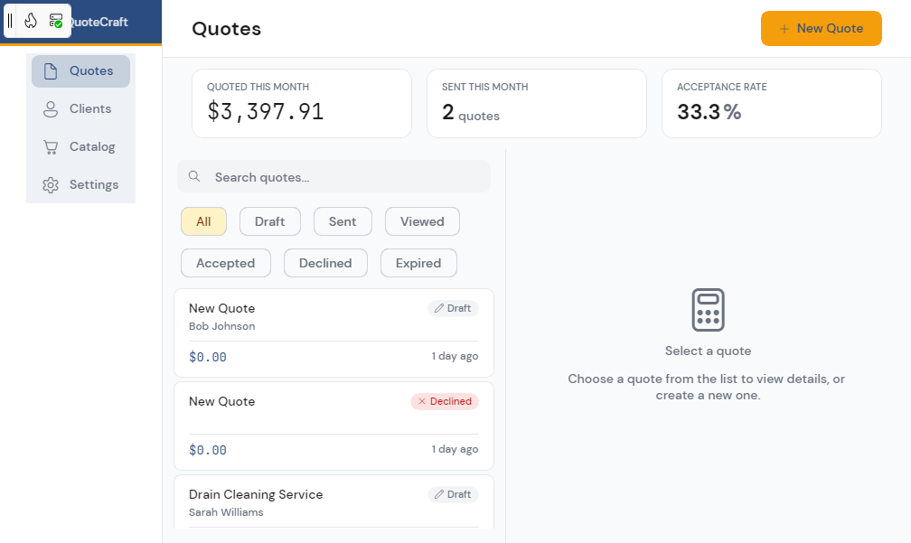
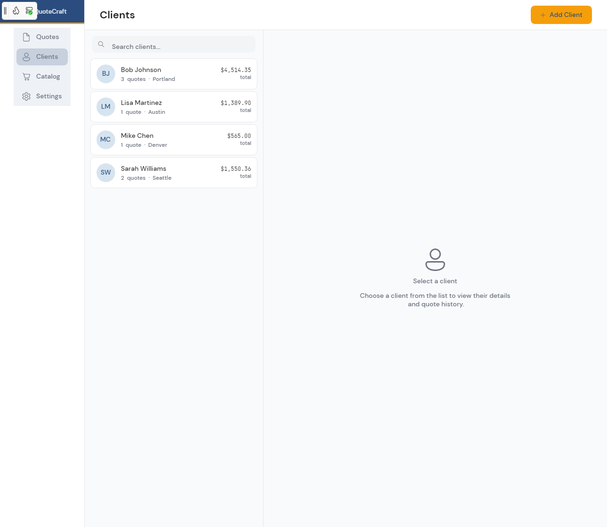
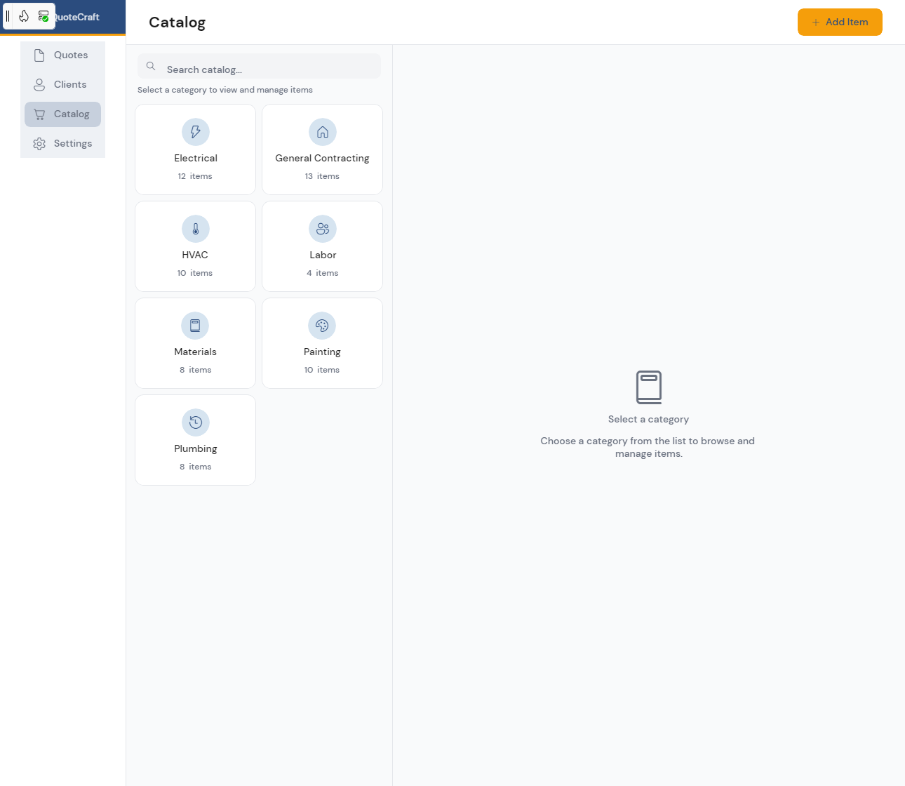
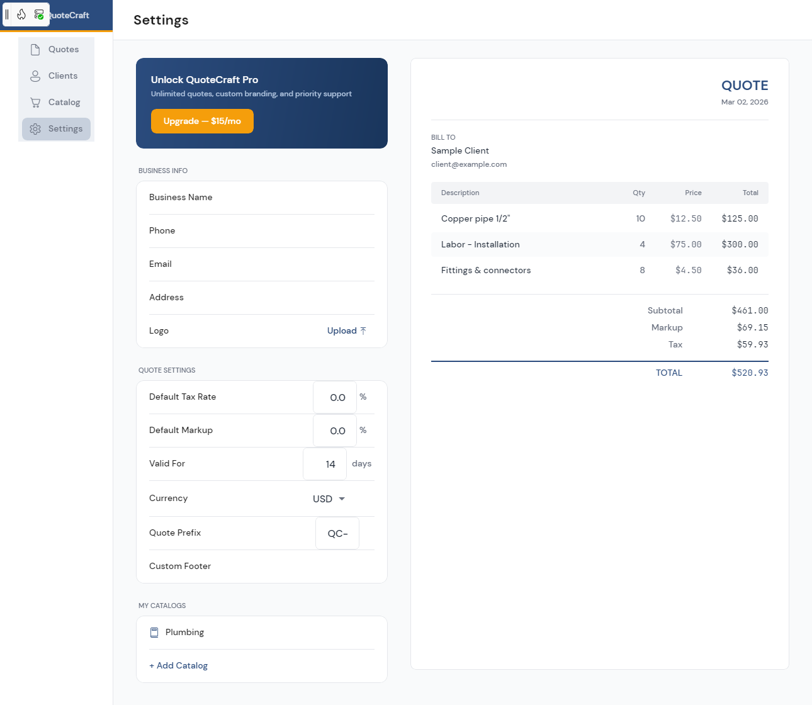

# QuoteCraft

A professional quoting and invoicing app for contractors and small businesses, built with [Uno Platform](https://platform.uno) and .NET 10.

QuoteCraft helps service professionals create, manage, and send quotes to clients — all from a single cross-platform application that runs on Windows, macOS, Linux, iOS, Android, and WebAssembly.



## Features

- **Quote Management** — Create, edit, duplicate, and track quotes with status indicators (Draft, Sent, Viewed, Accepted, Declined, Expired); sent quotes expire after their validity period, with a reminder 3 days before, and an expired quote can be reopened and sent again
- **Client Directory** — Maintain a searchable client database with contact details and quote history
- **Service Catalog** — Organize services and materials into categories (Electrical, Plumbing, HVAC, etc.) with preset pricing
- **PDF Generation** — Generate professional PDF quotes ready to send to clients (desktop and Windows apps; see [Platform notes](#platform-notes))
- **Email Integration** — Send quotes directly to clients via email
- **Dashboard Analytics** — At-a-glance metrics including monthly totals, send counts, and acceptance rates with sparkline charts
- **Quote Editor** — Line-item editor with quantity, pricing, tax rate, markup, and custom footer support; subtotal, tax and total as the PDF shows them, and the quote's status history
- **Light, Dark or System theme** — Follows the system by default; choose Light or Dark in Settings (Appearance) or from the side rail's Theme menu, and the choice is remembered
- **Responsive Layout** — Four layouts, from a 360 px phone to a wide desktop: bottom tabs and one pane below 800 px, the side rail from 800 px, list and detail side by side from 1080 px (see [Layouts](#layouts))
- **Business Profile** — Configure company name, phone, email, address, logo, and default quote settings
- **Onboarding Flow** — Guided setup for new users to configure their business profile

## Screenshots

| Dashboard | Clients | Catalog | Settings |
|:---------:|:-------:|:-------:|:--------:|
|  |  |  |  |

## Tech Stack

- **Framework:** [Uno Platform](https://platform.uno) 7.0 preview (`Uno.Sdk` 7.0.0-dev.115, Single Project)
- **Runtime:** .NET 10
- **Renderer:** Skia
- **UI:** WinUI / XAML with Uno Toolkit controls
- **Design System:** Material Design 3 (Uno Material)
- **Architecture:** MVUX (Model-View-Update-eXtended)
- **Navigation:** Uno Navigation Extensions (region-based)
- **Dependency Injection:** Microsoft.Extensions.Hosting
- **Database:** SQLite, encrypted with SQLCipher (Microsoft.Data.Sqlite + SQLitePCLRaw), local-first
- **PDF:** QuestPDF (desktop and Windows)
- **Cloud (optional):** Supabase sign-in and Stripe billing (cloud sync is off in this version); see [Local-first, with optional sign-in and billing](#local-first-with-optional-sign-in-and-billing)

## Project Structure

```
├── QuoteCraft.sln
├── global.json
├── Directory.Build.props
├── Directory.Packages.props
├── docs/                                # PRD, architecture, design and revenue-model briefs; production-readiness decisions
├── QuoteCraft.Tests/                    # xUnit tests: money rules, quote numbering and migrations, status and expiry, line items,
│                                        # client links, concurrent database access (real temporary databases), feature gates, …
└── QuoteCraft/
    ├── QuoteCraft.csproj
    ├── App.xaml / App.xaml.cs          # App shell, DI, routing, styles
    ├── Presentation/                    # Pages and MVUX models
    │   ├── Shell.xaml                   # Splash screen container
    │   ├── MainPage.xaml                # Side rail + content region layout
    │   ├── DashboardPage.xaml           # Quote list with analytics
    │   ├── ClientsPage.xaml             # Client directory
    │   ├── CatalogPage.xaml             # Service/material catalog
    │   ├── SettingsPage.xaml            # Business profile & quote config
    │   ├── QuoteEditorPage.xaml         # Line-item quote editor (clients and catalog items edit in dialogs)
    │   └── OnboardingPage.xaml          # First-run setup wizard
    ├── Models/                          # Data entities
    ├── Data/                            # SQLite database & repositories
    ├── Services/                        # PDF, email, sharing, feature gates
    ├── Styles/                          # Color palette, status colors, layout tokens (Layout.xaml)
    ├── Helpers/                         # Value converters & utilities
    ├── Controls/                        # Custom controls (sparkline, status pill)
    └── Assets/                          # Fonts (DM Sans, JetBrains Mono), icons
```

## Prerequisites

- [.NET 10 SDK](https://dotnet.microsoft.com/download/dotnet/10.0)
- [Uno Platform extension](https://platform.uno/docs/articles/get-started.html) for your IDE (Visual Studio, VS Code, or Rider)
- Run `uno-check` to verify your environment:
  ```bash
  dotnet tool install -g uno.check
  uno-check
  ```

## Getting Started

1. **Clone the repository**
   ```bash
   git clone https://github.com/mtmattei/QuoteCraft.git
   cd QuoteCraft
   ```

2. **Restore and build**
   ```bash
   dotnet build QuoteCraft/QuoteCraft.csproj -f net10.0-desktop
   ```

3. **Run the app**
   ```bash
   dotnet run --project QuoteCraft/QuoteCraft.csproj -f net10.0-desktop
   ```

4. **Run the tests**
   ```bash
   dotnet test QuoteCraft.Tests/QuoteCraft.Tests.csproj -p:QuoteCraftTargetFrameworks=net10.0-desktop
   ```
   `QuoteCraftTargetFrameworks` limits the app to one head, so a restore needs no mobile workload. CI
   (`.github/workflows/ci.yml`) uses it for every job.

### Target Frameworks

| Platform | Target Framework |
|----------|-----------------|
| Windows / macOS / Linux (Skia) | `net10.0-desktop` |
| Windows (WinAppSDK, packaged) | `net10.0-windows10.0.19041` (x64 or ARM64) |
| Android | `net10.0-android` |
| iOS | `net10.0-ios` |
| WebAssembly | `net10.0-browserwasm` |

iOS builds on macOS and the WinAppSDK head on Windows; elsewhere the SDK skips them.

### Platform notes

| | Desktop | Windows (WinAppSDK) | Android | iOS | WebAssembly |
|---|---|---|---|---|---|
| Local database | SQLCipher, encrypted | SQLCipher, encrypted | SQLCipher, encrypted | SQLCipher, encrypted | SQLite in IndexedDB, not encrypted |
| PDF export | Yes | Yes | No (a note says so) | No (a note says so) | No (a note says so) |

The reasons, and the options for PDF export on the other heads, are in
[docs/DECISIONS-production-readiness.md](docs/DECISIONS-production-readiness.md).

## Layouts

Every page uses the Uno Toolkit's `utu:Responsive` with the default breakpoints:

| Category | Window width | Navigation | Quotes, Clients, Catalog | Settings, editor, onboarding |
|---|---|---|---|---|
| Narrow | below 600 | bottom tabs | one pane: the list, or the picked item with a back button; search under the title | one column, 16 px sides |
| Normal | 600 to 800 | bottom tabs | one pane, header on one row | one column, 24 px sides |
| Wide | 800 to 1080 | side rail | one pane, stat cards above the list | one column, capped and centred |
| Widest | 1080 and up | side rail | list and detail side by side, page capped at 1600 px | Settings adds the live quote preview from 1400 px |

Spacing, insets, widths, radii and touch sizes are tokens in `QuoteCraft/Styles/Layout.xaml`; colours are theme
resources (`Styles/ColorPaletteOverride.xaml`, `Styles/StatusColors.xaml`, `App.xaml`). Screenshots of each page at
360, 599, 600, 800, 1080 and 1920 px in Light and Dark are in [docs/evidence](docs/evidence).

## Local-first, with optional sign-in and billing

QuoteCraft runs entirely on the device: quotes, clients, the catalog and settings live in the local database, and no
account is needed. Without a Supabase project there are no plans, so no quote or client limits and no watermark;
Settings shows that data stays on this device.

Sign-in, plans and billing appear only when the app is given a Supabase project:

1. Create a Supabase project and apply `supabase/migrations` (tables, then row-level security).
2. Deploy `supabase/functions` and set their secrets as listed in [supabase/README.md](supabase/README.md).
3. Put the project URL and **anon** key in `QuoteCraft/appsettings.json`:
   ```json
   "Supabase": {
     "Url": "https://YOUR-PROJECT.supabase.co",
     "AnonKey": "YOUR-ANON-KEY",
     "CustomerPortalUrl": "https://billing.stripe.com/p/login/YOUR-PORTAL-LINK"
   }
   ```
   On desktop, `QUOTECRAFT_SUPABASE_URL` and `QUOTECRAFT_SUPABASE_ANON_KEY` override the file.

The anon key is meant for clients (row-level security protects the data). Never put the service-role key in the
app: it bypasses row-level security and belongs to the Edge Functions only. Keep real values out of commits.

**Cloud sync is off in this version, with or without a project:** quotes, clients, the catalog and settings stay on the
device, and Settings says so. The sync service would upload quotes without their line items (so they arrive at $0),
and never the catalog or the business profile; what it needs before it is turned on is in
[docs/DECISIONS-production-readiness.md](docs/DECISIONS-production-readiness.md) (D8). Other gaps with a project
configured: the sign-in page is reachable only through Sign Out, and the sign-in refresh token is kept in a plain
file in the app's data folder, not in the platform's secure store.

## UnoFeatures

The project uses the following [Uno SDK features](https://aka.platform.uno/singleproject-features):

| Feature | Purpose |
|---------|---------|
| Material | Material Design 3 theme and styles |
| Toolkit | Extended UI controls (TabBar, AutoLayout, Card, etc.) |
| MVUX | Reactive state management with feeds and states |
| Navigation | Region-based declarative navigation |
| Hosting | Microsoft.Extensions dependency injection |
| Configuration | App configuration and settings |
| Http | HTTP client integration |
| Serialization | JSON serialization |
| Logging | Structured logging |
| SkiaRenderer | Cross-platform Skia rendering backend |

## License

This project is provided as-is for demonstration and educational purposes.
